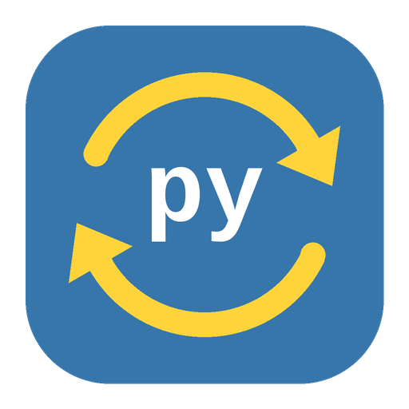

<p align="center"></p>

# Pyscript Updater

[](https://my.home-assistant.io/redirect/hacs_repository/?owner=TriTue2011&repository=pyscripts-updater&category=integration)

Tích hợp Home Assistant giữ các tệp **pyscript** của bạn luôn mới theo GitHub. Mỗi tệp trong danh sách nguồn là một thực thể `update`: có bản mới thì bấm **Cài đặt** (hoặc bật tự cập nhật). Bản cũ được sao lưu xoay vòng và khôi phục được.

Học theo [Blueprints Updater](https://github.com/luuquangvu/blueprints-updater) của luuquangvu (giấy phép MIT), làm gọn lại cho pyscript và thêm các lớp an toàn bên dưới.

## Cài đặt

1. HACS → ⋮ → **Kho tuỳ chỉnh** → dán `https://github.com/TriTue2011/pyscripts-updater`, loại **Tích hợp**.
2. Tải về, khởi động lại Home Assistant.
3. **Cài đặt → Thiết bị & dịch vụ → Thêm tích hợp → Pyscript Updater**.

> Mã tích hợp (domain) là `pyscript_updater`, giống bản đang chạy trước đây, nên thực thể và cấu hình cũ giữ nguyên khi bạn nâng cấp.

## Danh sách nguồn

Tạo tệp `/config/pyscript/_sources.txt`, mỗi dòng `url | đích | recursive` (cột thứ ba không bắt buộc, dòng bắt đầu bằng `#` là ghi chú):

```text
# một tệp
https://github.com/user/repo/blob/main/scripts/den.py | den.py
# cả thư mục (đích kết thúc bằng /), kèm thư mục con
https://github.com/user/repo/tree/main/scripts | ./ | recursive
```

## Tuỳ chọn

| Mục | Mặc định | Ý nghĩa |
|---|---|---|
| Thư mục pyscript | `/config/pyscript` | Nơi ghi tệp |
| Tệp danh sách nguồn | `_sources.txt` | Đường dẫn tương đối hoặc tuyệt đối |
| Chu kỳ kiểm | 24 giờ | 1–720 giờ |
| Tự cập nhật | tắt | Có bản mới thì tự cài (luôn sao lưu trước) |
| Nạp lại pyscript sau cập nhật | bật | Gọi `pyscript.reload` |
| Số bản sao lưu | 3 | 1–10 (`tệp.bak.1` là mới nhất) |
| Token GitHub | trống | Tăng hạn mức API, dùng cho repo riêng |

## Dịch vụ (quản trị viên)

- `pyscript_updater.reload` — đọc lại danh sách nguồn và kiểm ngay.
- `pyscript_updater.update_all` — cài mọi bản cập nhật đang chờ (`backup: true|false`).
- `pyscript_updater.restore_pyscript` — khôi phục một tệp từ `.bak.N`.

## An toàn

Tệp pyscript là mã chạy trong Home Assistant, nên bản này chặn ba chỗ hay gặp:

- **Chỉ tải từ GitHub** (`github.com`, `raw.githubusercontent.com`, `api.github.com`, bắt buộc `https`). Dòng nguồn khác bị bỏ qua và ghi cảnh báo vào log.
- **Token chỉ gửi tới các máy chủ GitHub trên**, không bao giờ tới máy chủ khác.
- **Đích không thoát khỏi thư mục pyscript**: chặn `..`, đường dẫn tuyệt đối và liên kết tượng trưng trỏ ra ngoài, cả khi cài lẫn khi khôi phục.

Lưu ý: tự cập nhật từ nhánh `main` của repo bên thứ ba nghĩa là bạn tin người giữ repo đó. Nếu không chắc, để tự cập nhật tắt và xem thay đổi trước khi bấm cài.

Bạn sửa tay một tệp pyscript thì nó sẽ hiện «có bản cập nhật» (vì khác bản trên GitHub); cài sẽ ghi đè, bản của bạn nằm ở `.bak.1`.

## Phát triển

```bash
pip install homeassistant pytest
python -m pytest
```

## Giấy phép

MIT. Xem [LICENSE](LICENSE); mô hình tham khảo thuộc luuquangvu.

---

## English

Home Assistant integration that keeps your **pyscript** files in sync with GitHub: each file in `/config/pyscript/_sources.txt` becomes an `update` entity, with rotating backups, restore and optional auto-update. Inspired by [Blueprints Updater](https://github.com/luuquangvu/blueprints-updater) (MIT). Downloads only from GitHub over HTTPS, sends the token only to GitHub, and refuses destinations outside the pyscript directory. Install through HACS as a custom repository (category *Integration*); the domain stays `pyscript_updater`.
